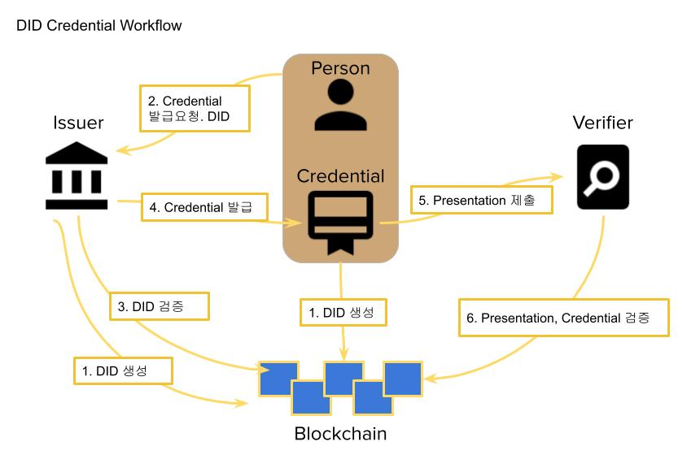

# Metadium DID SDK for Java

[English](README.md) | 한국어

Metadium 네트워크에서 DID 생성 및 키 관리 기능과 [Verifiable Credential](https://www.w3.org/TR/vc-data-model/) 의 서명과 검증 기능을 Java 또는 Android 에 제공하는 SDK 입니다.

## 용어정리

- **DID (탈중앙화 신원증명 : Decentralized Identifier)**
    - 개인의 데이터를 중앙화된 기관을 거치지 않으면서도 검증이 가능하게 하는 개념.
    - [W3C DID Spec](https://www.w3.org/TR/did-core/)
- **Claim**
    - 전체 데이터의 각 단위 데이터 입니다.
    - 예를 들어 디지털 신원 정보에서 이름, 생년월일, 성별 등과 각각의 값을 페어로 claim 이라 부릅니다.
    - [W3C VC Claims](https://www.w3.org/TR/vc-data-model/#claims)
- **Verifiable Credential (VC)**
    - 발급자, 유효기한, 검증에 사용되는 발급자의 공개키 등과 claim 의 집합과 서명을 포함하는 검증 가능한 Credential 입니다.
    - 위변조가 불가능하며 예로 휴대폰 본인인증, 전자신분증 등 신원인증이 있습니다.
    - 발급자가 사용자의 정보를 인증하여 발급하고 사용자에게 전달됩니다.
    - [W3C VC Credential](https://www.w3.org/TR/vc-data-model/#credentials)
- **Verifiable Presentation (VP)**
    - 하나 이상의 Verifiable Credential 과 소유자의 공개키와 서명을 포함하는 검증 가능한 Presentation 입니다.
    - 소유자가 발급자에게서 발급 받은 credential 을 검증자에게 제출할 때 사용됩니다.
    - [W3C VC Presentation](https://www.w3.org/TR/vc-data-model/#presentations)

## DID Workflow



1. 발급자(Issuer)와 사용자(Holder)는 Credential, Presentation 을 발급하기 위해 DID 를 미리 생성한다.
    - [DID 생성](#did-생성)
2. 사용자는 발급자에게 Credential 발급 요청을 한다. 사용자가 발급하려는 Credential 의 소유자임을 확인하기 위해 DID 를 전달한다.
    - 전달하는 DID 에 대한 검증이 필요할 시 Credential 을 포함하지 않는 Presentation 을 전달한다.
    - [Presentation 발급](#presentation-발급)
3. 발급자는 사용자의 DID 를 확인한다.
    - DID 가 presentation 으로 제출되면 presentation 을 검증한다.
    - [Credential, Presentation 검증](#credential-또는-presentation-검증)
4. 확인된 claim 을 포함하는 Credential 을 발급한다. 사용자에게 전달된 Credential 은 안전한 저장공간에 저장한다.
    - [Credential 발급](#credential-발급)
5. 사용자는 검증자(Verifier)가 요구하는 Credential 을 찾아 Presentation 을 만들어 제출한다.
    - [Presentation 발급](#presentation-발급)
6. 검증자는 Presentation 이 사용자가 보낸 것인지, 요구하는 발급자의 Credential 인지 검증한다.
    - [Credential, Presentation 검증](#credential-또는-presentation-검증)

[전체 테스트 코드](src/test/java/com/metadium/did/WorkflowTest.java)

## SDK Setup

SDK 는 필수사항으로 Java 1.8 을 요구합니다.

Maven 설정:

```xml
<properties>
	<maven.compiler.target>1.8</maven.compiler.target>
	<maven.compiler.source>1.8</maven.compiler.source>
</properties>

<!-- JitPack repository 사용 -->
<repositories>
    <repository>
        <id>jitpack.io</id>
        <url>https://jitpack.io</url>
    </repository>
</repositories>

<dependency>
    <groupId>com.github.METADIUM</groupId>
    <artifactId>did-sdk-java</artifactId>
    <version>0.4.0</version>
    <!-- <version>0.4.0-android</version> --> <!-- Android 경우 해당 버전 사용 -->
</dependency>
```

Gradle 설정:

```gradle
android {
    compileOptions {
        sourceCompatibility JavaVersion.VERSION_1_8
        targetCompatibility JavaVersion.VERSION_1_8
    }

    dependencies {
        implementation 'com.github.METADIUM:did-sdk-java:0.4.0'
        //implementation 'com.github.METADIUM:did-sdk-java:0.4.0-android' // Android 경우 해당 버전 사용
    }
}

allprojects {
    repositories {
        google()
        jcenter()
        maven { url "https://jitpack.io" }  // JitPack repository 사용
    }
}
```

> [외부 키 보관 서비스 지원](#외부-키-보관-서비스)은 0.4.0 릴리스부터 제공됩니다. 0.4.0 이전 릴리스에는 없습니다.

Runtime 에서 ``java.lang.NoSuchMethodError: okhttp3.RequestBody.create(Ljava/lang/String;Lokhttp3/MediaType;)Lokhttp3/RequestBody;`` 에러가 발생하면 okhttp3 를 아래와 같이 추가하십시오.

```xml
<dependency>
	<groupId>com.squareup.okhttp3</groupId>
	<artifactId>okhttp</artifactId>
	<version>4.9.0</version>
</dependency>
```

## 사용방법

* [네트워크 설정](#네트워크-설정)
* [DID 기능](#did-기능)
    * [DID 생성](#did-생성)
    * [DID 삭제](#did-삭제)
    * [DID document 확인](#did-document-확인)
    * [DID 확인](#did-존재-확인)
    * [지갑 저장](#지갑-저장)
    * [지갑 불러오기](#지갑-불러오기)
    * [서명](#서명)
* [외부 키 보관 서비스](#외부-키-보관-서비스)
    * [외부 키로 DID 생성](#외부-키로-did-생성)
    * [외부 키로 Credential, Presentation 발급](#외부-키로-credential-presentation-발급)
    * [서명 형식](#서명-형식)
* [Verifiable Credential](#verifiable-credential)
    * [Credential 발급](#credential-발급)
    * [Presentation 발급](#presentation-발급)
    * [Credential 또는 Presentation 검증](#credential-또는-presentation-검증)
    * [Presentation 에서 Credential 목록 확인](#presentation-에서-credential-목록-확인)
    * [Credential 에서 claim 목록 확인](#credential-에서-claim-목록-확인)

### 네트워크 설정

DID 를 생성 및 사용하기 위한 네트워크 설정을 설명합니다.

Delegator, Node, Resolver 의 end-point 와 did prefix 를 설정합니다.

Metadium mainnet, testnet 을 사용할 때는 apiKey 를 Metadium 에서 발급받아야 합니다.

```java
String apiKey = "......"; // 발급 필요

// Metadium Mainnet 설정
MetaDelegator delegator = new MetaDelegator(apiKey);

// Metadium Testnet 설정
MetaDelegator delegator = new MetaDelegator("https://testdelegator.metadium.com", "https://api.metadium.com/dev", "did:meta:testnet", apiKey);
DIDResolverAPI.getInstance().setResolverUrl("https://testnetresolver.metadium.com/1.0/");

// Custom network 설정. private network 일 때 해당 네트워크의 각 end-point 를 설정합니다.
MetaDelegator delegator = new MetaDelegator("https://custom.delegator.metadium.com", "https://custom.api.metadium.com", "did:meta:custom");
DIDResolverAPI.getInstance().setResolverUrl("https://custom.resolver.metadium.com/1.0/");
```

### DID 기능

DID 생성/삭제 등의 기능을 설명합니다.

#### DID 생성

Secp256k1 key pair 를 생성하고 해당 키로 DID 를 생성합니다.

```java
// 임의의 키로 DID 생성
MetadiumWallet wallet = MetadiumWallet.createDid(delegator);

// Wallet 에서 생성된 DID 정보 확인
MetadiumKey key = wallet.getKey();                             // DID 를 생성시킨 개인키
String did = wallet.getDid();                                  // 생성된 DID. ex) did:meta:00000000000000000000000000000000000000000000000000000000000432a0
String kid = wallet.getKid();                                  // 생성된 key 의 id. ex) did:meta:00000000000000000000000000000000000000000000000000000000000432a0#MetaManagementKey#234f9445cd405a2a454245b94f7bc5e9286912eb
BigInteger privateKey = wallet.getKey().getPrivateKey();       // EC private key. BigInteger
ECPrivateKey ecPrivateKey = wallet.getKey().getECPrivateKey(); // EC private key. ECPrivateKey
```

외부 키 보관 서비스에 있는 키로 DID 를 생성하려면 [외부 키 보관 서비스](#외부-키-보관-서비스)를 참조하십시오.

#### DID 삭제

```java
wallet.deleteDid(delegator);
```

#### DID document 확인

```java
DidDocument didDocument = wallet.getDidDocument();
```

##### DID 존재 확인

DID 가 블록체인에 존재하는지 확인합니다.

```java
wallet.existsDid(delegator);
```

##### 지갑 저장

```java
// serialize
String walletJson = wallet.toJson();

// Java    : wallet json 을 암호화 하여 파일에 저장한다.
//
// Android : wallet json 을 AndroidKeystore 로 암호화 하여 파일 또는 SharedPreference 에 저장한다.
//           https://developer.android.com/reference/androidx/security/crypto/package-summary 참조
```

`toJson()` 은 개인키를 직렬화합니다. [외부 키 보관 서비스](#외부-키-보관-서비스)의 키를 쓰는 지갑에서는 `UnsupportedOperationException` 이 발생합니다.

##### 지갑 불러오기

```java
// Java    : 파일 복호화
//
// Android : 파일 또는 SharedPreference 에서 복호화
//           https://developer.android.com/reference/androidx/security/crypto/package-summary 참조

// deserialize
MetadiumWallet newWallet = MetadiumWallet.fromJson(walletJson);
```

#### 서명

DID 의 키로 서명([Elliptic Curve Digital Signature Algorithm](https://en.wikipedia.org/wiki/Elliptic_Curve_Digital_Signature_Algorithm))을 합니다.

```java
byte[] message = "message".getBytes();
SignatureData signature = wallet.getKeyImpl().sign(message); // 로컬 키는 wallet.getKey().sign(message) 도 가능
```

서명값을 16진수 문자열로 변환하는 예시 함수입니다.

```java
public static String signatureDataToString(Sign.SignatureData signatureData) {
    ByteBuffer buffer = ByteBuffer.allocate(65);
    buffer.put(signatureData.getR());
    buffer.put(signatureData.getS());
    buffer.put(signatureData.getV());
    return Numeric.toHexString(buffer.array());
}
```

### 외부 키 보관 서비스

개인키를 외부 키 보관 서비스(HSM, KMS, 지갑 서비스)에 두고 SDK 에는 전달하지 않을 수 있습니다. SDK 에는 공개키와 32바이트 다이제스트를 서명해 주는 콜백만 필요합니다.

#### 외부 키로 DID 생성

키 보관 서비스를 호출하는 `DigestSigner` 를 구현하고 `ExternalMetadiumKey` 를 `MetadiumWallet.createDid` 에 전달합니다.

```java
// 키 보관 서비스가 가진 secp256k1 개인키로 다이제스트를 그대로 서명한다.
// r||s (64바이트), r||s||v (65바이트) 또는 ASN.1 DER (AWS KMS, Google Cloud KMS 가 반환하는 형식) 를 반환한다.
DigestSigner signer = digest -> keyStoreClient.signDigest(keyId, digest);

// 키 보관 서비스가 반환한 공개키 바이트를 그대로 전달한다.
// X||Y (64바이트), 0x04||X||Y (65바이트), 압축 (33바이트) 또는 X.509 SubjectPublicKeyInfo DER (AWS KMS, Google Cloud KMS GetPublicKey) 를 받는다.
// secp256k1 곡선 위의 점이 아니면 IllegalArgumentException 이 발생한다.
ExternalMetadiumKey key = ExternalMetadiumKey.fromPublicKeyBytes(keyStoreClient.getPublicKey(keyId), signer);

MetadiumWallet wallet = MetadiumWallet.createDid(delegator, key);   // delegator 를 통해 DID 등록
String did = wallet.getDid();
```

참고:

* 키 보관 서비스가 `v` 를 반환하지 않아도 됩니다. SDK 가 공개키로 `v` 를 복원하며, `s` 가 큰 값이면 정규형(low-s)으로 변환합니다.
* DER 서명(AWS KMS, Google Cloud KMS)은 변환 없이 그대로 받을 수 있습니다.
* 서명이 공개키와 맞는지 확인합니다. 키 보관 서비스가 다른 키로 서명하면 검증자 단계가 아니라 서명 시점에 바로 실패합니다. `createDid` 같은 지갑 기능 안에서는 `DidException` (cause 가 `IllegalStateException`), `ExternalMetadiumKey#sign` 을 직접 호출하면 `IllegalStateException`, VC / VP 는 `JOSEException` 입니다.
* 개인키가 없으므로 `wallet.getKey()` 와 `wallet.toJson()` 은 `UnsupportedOperationException` 이 발생합니다. `wallet.getKeyImpl()` 을 사용하십시오.
* `updateKeyOfDid`, `deleteDid`, `addServiceKey` 등 다른 지갑 기능도 외부 키로 동일하게 동작합니다. `MetaDelegator` 메서드는 `MetadiumKeyImpl` 을 받습니다.
* 나중에 지갑을 복원하려면 저장해 둔 DID 와 키로 생성합니다: `new MetadiumWallet(did, key)`.
* `DigestSigner` 는 호출한 스레드에서 동기로 실행되며 보통 네트워크 호출입니다. UI 스레드(Android)에서 호출하지 마십시오.
* DID 전용 키를 사용하십시오. 키 보관 서비스는 임의의 32바이트 다이제스트에 서명하므로 같은 키로 블록체인 트랜잭션을 서명하지 않아야 합니다.

##### 실패 처리
여러 트랜잭션으로 이루어진 작업(DID 생성, 키 변경, DID 삭제)은 외부 키 보관 서비스 서명이 어느 단계에서든 실패할 수 있습니다. SDK 는 모든 실패에 `DidException` 을 던지며 원인 예외를 cause 로 담습니다. 일부 트랜잭션이 이미 완료된 경우에는 `DidPartialFailureException` 을 던집니다.

* `getDid()`, `getCompletedSteps()` (트랜잭션 해시 포함), `getUnrecoveredSteps()` 는 로그용 텍스트입니다.
* 프로그램에서 쓰려면 `getSteps()` 와 `getCompensationSteps()` 를 사용합니다. 작업(`CREATE_IDENTITY`, `ADD_PUBLIC_KEY` 등), 대상 키(`CURRENT_KEY`, `NEW_KEY`), 트랜잭션 해시, 상태를 가진 `DidStep` 목록입니다.
  * `CONFIRMED`: 변경이 체인에 반영되었습니다.
  * `FAILED`: 트랜잭션이 revert 되어 아무것도 바뀌지 않았습니다.
  * `SUBMITTED_UNCONFIRMED`: 트랜잭션은 제출되었지만 receipt 를 읽지 못했습니다(타임아웃, 네트워크 오류). 나중에 블록에 들어갈 수 있어 결과를 알 수 없습니다. 이때 SDK 는 **되돌리지 않습니다**. 다른 단계를 되돌리면 상태가 더 나빠질 수 있기 때문입니다. `getUnrecoveredSteps()` 가 확인할 트랜잭션을 알려 줍니다(`check <작업>(<대상>) tx=<해시> ...`). 노드에서 해시를 확인한 뒤 판단하십시오.
* `createDid` 와 `updateKeyOfDid` 는 완료된 단계를 되돌립니다(`SUBMITTED_UNCONFIRMED` 단계가 있으면 제외). 보상 단계 하나가 실패해도 나머지를 계속 시도하며, 그 오류는 cause 의 suppressed 예외로 붙습니다. 모두 되돌렸으면 `getUnrecoveredSteps()` 는 비어 있고, 아니면 남은 단계가 담깁니다.
* delegator 호출 자체가 실패한 경우(예: delegator 가 트랜잭션을 전파한 뒤 응답을 잃음)에는 트랜잭션 해시가 없어 `SUBMITTED_UNCONFIRMED` 가 될 수 없습니다. "제출되지 않음"으로 보고 보상을 실행합니다.
* `deleteDid` 는 되돌리지 않습니다. 공개키만 삭제된 경우 `getUnrecoveredSteps()` 에 `remove associated_key` 가 담깁니다.
* 보상 단계는 트랜잭션이 실패한 경우뿐 아니라 외부 서명자가 예외를 던진 경우에도 실행됩니다.

#### 외부 키로 Credential, Presentation 발급

`ExternalMetadiumKey#getJWSSigner()` 는 같은 `DigestSigner` 를 사용하며 서명이 공개키와 맞는지 확인하는 ES256K `JWSSigner` 를 반환합니다.

```java
JWSSigner jwsSigner = key.getJWSSigner();

SignedJWT vc = wallet.issueCredential(
        Collections.singletonList("StudentCredential"),
        URI.create("http://aa.metadium.com/credential/student/1"),
        issuanceDate,
        expirationDate,
        holderDid,
        claims,
        jwsSigner                       // 외부 키 보관 서비스의 서명자
);

SignedJWT vp = wallet.issuePresentation(types, id, issuanceDate, expirationDate, vcList, jwsSigner);

// 임의의 Verifiable 을 직접 서명할 수도 있다
SignedJWT jwt = wallet.sign(verifiable, claimsSet, jwsSigner);
```

전달한 `JWSSigner` 는 지갑의 키와 맞는지 확인합니다. Credential 의 `kid` 가 지갑의 키를 가리키므로, 서명이 지갑의 공개키로 검증되지 않으면 `JOSEException` 이 발생합니다.

서명자를 받지 않는 메서드는 로컬 개인키로 서명하며, 지갑이 `ExternalMetadiumKey` 를 가지면 키 보관 서비스로 서명합니다.

공개키 없는 `new ExternalJWSSigner(DigestSigner)` 는 다른 키로 서명하는 것을 감지할 수 없어 deprecated 입니다. `ExternalMetadiumKey#getJWSSigner()` 를 사용하십시오.

#### 서명 입력을 키 보관 서비스가 직접 해시하는 경우

`DigestSigner` 는 32바이트 다이제스트를 그대로 서명하는 키 보관 서비스에 맞습니다. 데이터를 받아 직접 해시하는 키 보관 서비스라면 `RawSigner` 를 구현하고, VC / VP 에는 `ExternalMetadiumKey#getRawJWSSigner(RawSigner)` 를 사용합니다.

| | `DigestSigner` + `getJWSSigner()` | `RawSigner` + `getRawJWSSigner(rawSigner)` |
|---|---|---|
| JWS signing input 을 해시하는 쪽 | SDK (SHA-256) | 키 보관 서비스 (SHA-256) |
| 받는 값 | 32바이트 다이제스트 | 서명 입력 `BASE64URL(header).BASE64URL(payload)` 바이트 |
| 반환 | `r‖s`, `r‖s‖v`, DER | `r‖s`, `r‖s‖v`, DER |
| SDK 가 확인 | 범위, low-s, 공개키 | 범위, low-s, 공개키 |

키 보관 서비스는 SHA-256 으로 해시하고 secp256k1 으로 서명해야 합니다. Delegator 요청(DID 생성, 키 추가/삭제)은 keccak256 다이제스트에 서명하므로 항상 키의 `DigestSigner` 로 서명합니다.

```java
RawSigner raw = signingInput -> keyStoreClient.signWithSha256(keyId, signingInput);
SignedJWT vc = wallet.issueCredential(types, id, null, null, ownerDid, subjects, key.getRawJWSSigner(raw));
```

#### 검증자 challenge 에 대한 Presentation

`issuePresentation(types, id, issuanceDate, expirationDate, vcList, signer, challenge, audience)` 는 검증자의 challenge 를 `nonce` 클레임에, audience 를 `aud` 클레임에 넣습니다. challenge 가 없으면 이전처럼 SDK 가 임의 `nonce` 를 만듭니다. 전달한 `JWTClaimsSet` 의 `nonce` 클레임은 항상 교체되므로, 이 메서드(또는 `sign(verifiable, claimsSet, signer, nonce)`)로 지정하십시오.

#### 작업의 트랜잭션 확인

`createDid`, `updateKeyOfDid`, `deleteDid` 에는 `List<DidStep>` 을 받는 오버로드가 있습니다. 전송한 모든 트랜잭션이 순서대로 담기며 작업이 실패해도 담깁니다: 트랜잭션 해시, 상태, 확정된 단계의 블록 번호(`DidStep#getBlockNumber()`, 실패나 미확인 단계는 null). 목록은 호출자의 것이라 동시에 실행해도 섞이지 않습니다.

#### 실환경 스모크 테스트

[`RealEnvironmentSmokeTest`](src/test/java/com/metadium/did/smoke/RealEnvironmentSmokeTest.java) 는 외부 키 보관 서비스 지원을 실제 delegator, 노드, resolver 로 확인합니다. `smoke.delegator` 를 지정하지 않으면 건너뜁니다.

1. **드라이런 (체인에 쓰지 않음).** delegator 와 노드가 응답하는지, 다른 키의 서명이 트랜잭션을 보내기 전에 거부되는지 확인합니다.

```bash
mvn test -Dtest='RealEnvironmentSmokeTest#readOnlyDryRun' \
  -Dsmoke.delegator=https://delegator.example.com \
  -Dsmoke.node=https://node.example.com \
  -Dsmoke.resolver=https://resolver.example.com/1.0/ \
  -Dsmoke.prefix=did:meta:gov
```

2. **전체 시나리오 (체인에 씁니다).** 학생과 발급자 DID 두 개를 만들고, 노드와 resolver 에서 확인하고, VC 와 VP 를 발급·검증하고, 학생의 키를 변경한 뒤 새 키로 서명한 VP 를 검증하고, 두 DID 를 삭제합니다(실패해도 삭제를 시도합니다). 단계별 소요 시간과 키별 서명 횟수를 출력합니다. 확인 옵션이 없으면 실패합니다.

```bash
mvn test -Dtest='RealEnvironmentSmokeTest#externalKeyStoreLifecycle' \
  -Dsmoke.delegator=... -Dsmoke.node=... -Dsmoke.resolver=... -Dsmoke.prefix=... \
  -Dsmoke.apiKey=...          `# delegator 가 요구하면` \
  -Dsmoke.confirm=yes
```

기본값은 메모리의 키라서, 실제 키 보관 서비스가 준비되기 전에도 delegator, 노드, resolver 경로를 확인할 수 있습니다. 실제 키 보관 서비스를 쓰려면 [`SmokeKeyStore`](src/test/java/com/metadium/did/smoke/SmokeKeyStore.java) 를 구현한 클래스(키 `student`, `student-new`, `issuer` 의 공개키와 `DigestSigner` 를 반환)를 만들고 `-Dsmoke.keystore=com.example.MyKeyStore` 를 추가합니다. 테스트 전용 키를 사용하십시오.

전체 시나리오를 실행하기 전에 네트워크(테스트넷)와 delegator API 키를 가진 사람을 정하십시오. 실행이 출력하는 DID(단계가 실패한 경우에도)는 사후에 확인할 수 있도록 실행 결과를 남기는 PR 코멘트에 적어 두십시오. `createDid` 또는 `deleteDid` 가 중간에 끝나면(`DidPartialFailureException`) 테스트는 그 DID 의 완료된 단계, 복구되지 않은 단계, 트랜잭션 단계를 로그로 남깁니다. 정리 단계는 남은 것을 지웁니다. 반쯤 만들어진 DID 는 그 키로 `deleteDid` 를 호출하고, 반쯤 삭제된 DID 는 `deleteDid` 를 한 번 더 호출합니다(이미 삭제된 공개키를 다시 삭제하는 것은 revert 되지 않을 것으로 보이므로 남은 associated address 가 지워집니다. 체인에서 확인하지는 않았습니다). 그 뒤에도 남은 것은 로그로 남깁니다.

#### 서명 형식

| 용도 | 서명 대상 | 해시 | 결과 |
|---|---|---|---|
| Delegator 요청 (DID 생성, 키 추가/삭제 등) | 요청 메시지 `keccak256(0x19 ‖ 0x00 ‖ ...)` | keccak256, SDK 가 계산 | `DigestSigner` 는 32바이트 keccak256 다이제스트를 받는다. SDK 가 `r`, `s`, `v`(27 또는 28)를 구성한다. |
| VC / VP (JWS, `ES256K`) | JWS signing input | SHA-256, SDK 가 계산 | `DigestSigner` 는 32바이트 SHA-256 다이제스트를 받는다. SDK 는 `r‖s` (64바이트, low-s)를 사용한다. |

`DigestSigner` 는 항상 최종 다이제스트를 받으며, 추가 해시 없이 그대로 서명해야 합니다.

Metadium delegator 서버는 다이제스트 자체에 대한 서명과, `\x19Ethereum Signed Message:\n32` 접두를 붙인 다이제스트에 대한 서명을 모두 허용합니다 ([METADIUM/go-delegator](https://github.com/METADIUM/go-delegator/blob/64ac5a93485556ed59872e215dc9f2602d35d7eb/metaresolver/util.go#L15-L32) 의 `metaresolver/util.go`, `verifySignature` 가 둘 다 시도합니다). delegator 소스를 읽어 확인한 것이며, 외부 키 보관 서비스와 delegator 를 실제로 연동해 실행해 보지는 않았습니다. 이 SDK 는 다이제스트 자체를 서명합니다(`MetadiumKey#sign` 과 동일). did-sdk-swift 는 접두를 붙인 personal message 해시를 서명하므로, 두 SDK 를 모두 쓰는 키 보관 서비스는 SDK 마다 다른 다이제스트를 받으며 delegator 는 둘 다 허용합니다.

[키 보관 서비스를 흉내 낸 테스트](src/test/java/com/metadium/did/ExternalSignerTest.java)

### Verifiable Credential

Verifiable credential, Verifiable presentation 을 발급 및 검증하는 방법을 설명합니다.

#### Credential 발급

verifiable credential 을 발급합니다.
발급자(issuer)는 DID 가 생성되어 있어야 하며 credential 의 이름(types), 사용자(holder)의 DID, 발급할 내용(claims) 이 필수로 필요합니다.

아래는 여러 claim 을 포함하는 credential 을 발급하는 예제입니다.

```java
// set claims
Map<String, Object> claims = new HashMap<>();
claims.put("name", "YoungBaeJeon");
claims.put("birth", "19800101");
claims.put("id", "800101xxxxxxxx");

SignedJWT vc = wallet.issueCredential(
        Collections.singletonList("PersonalIdCredential"),         // types : credential 의 이름. "Credential" 로 끝나야 함.
        URI.create("http://aa.metadium.com/credential/name/343"),  // id : credential 을 검증할 수 있는 고유 URL. 필수는 아님.
        issuanceDate,                                              // issuance date
        expirationDate,                                            // expiration date
        "did:meta:0000000...00001345",                             // ownerDid (holder 의 did)
        claims                                                     // claims
);
String personalIdVC = vc.serialize();
```

위와 같이 발급받은 경우 검증자에게는 해당 credential 을 그대로 넘겨야 하기 때문에 특정 claim 만 선택해서 보내거나 불필요한 claim 을 감춰서 보낼 수는 없습니다.

특정 claim 만 선택해서 보내려면 아래와 같이 발급자가 claim 단위로 credential 을 나누어 발급해야 합니다.

```java
SignedJWT vc = wallet.issueCredential(
        Arrays.asList("PersonalIdCredential", "NameCredential"),   // PersonalIdCredential 의 NameCredential
        URI.create("http://aa.metadium.com/credential/name/343"),
        issuanceDate,
        expirationDate,
        "did:meta:0000000...00001345",
        Collections.singletonMap("name", "YoungBaeJeon")
);
String nameVC = vc.serialize();

SignedJWT vc = wallet.issueCredential(
        Arrays.asList("PersonalIdCredential", "BirthCredential"),  // PersonalIdCredential 의 BirthCredential
        URI.create("http://aa.metadium.com/credential/name/343"),
        issuanceDate,
        expirationDate,
        "did:meta:0000000...00001345",
        Collections.singletonMap("birth", "19800101")
);
String birthVC = vc.serialize();

SignedJWT vc = wallet.issueCredential(
        Arrays.asList("PersonalIdCredential", "IdCredential"),     // PersonalIdCredential 의 IdCredential
        URI.create("http://aa.metadium.com/credential/name/343"),
        issuanceDate,
        expirationDate,
        "did:meta:0000000...00001345",
        Collections.singletonMap("id", "800101xxxxxxxx")
);
String idVC = vc.serialize();
```

#### Presentation 발급

전달해야 하는 credential 의 목록을 포함하여 presentation 을 발급합니다.
검증자는 전달해야 하는 credential 의 types 를 소유자에게 알려주며, 소유자는 해당하는 credential 을 presentation 으로 전달하고, 발급된 presentation 은 검증자에게 전달되어 검증을 받습니다.

검증자가 2개의 credential(주민등록증, 운전면허증)을 요청하고 소유자가 presentation 을 발급하여 전달하는 예제:

```java
// 검증자 요청 예제 : {"types":["TestPresentation"], "vc":[["PersonalIdCredential"], ["DriverLicenseCredential"]]}
List<String> holderAllVc = ..; // 소유자의 전체 credential 목록

List<String> foundVcList = findVC(holderAllVc, Arrays.asList(Arrays.asList("PersonalIdCredential"), Arrays.asList("DriverLicenseCredential")));

SignedJWT vp = userWallet.issuePresentation(
        Collections.singletonList("TestPresentation"),          // presentation 의 이름. "Presentation" 으로 끝나야 하며 검증자가 지정해서 소유자에게 알려줘야 함.
        URI.create("http://aa.metadium.com/presentation/343"),  // id : presentation 을 검증할 수 있는 고유 URL. 필수는 아님.
        issuanceDate,                                           // issuance date
        expirationDate,                                         // expiration date
        foundVcList                                             // 전달할 credential 목록
);
String serializedVP = vp.serialize();
```

하나의 credential 에 여러 claim 을 포함하여 발급한 경우에는 특정 claim 만 요구하여 제출받을 수 없습니다.
claim 별로 credential 을 나눠서 발급했다면 아래처럼 제출할 수 있습니다. (주민등록증의 이름과 id 만 제출 요청)

```java
// 검증자 요청 예제 : {"types":["TestPresentation"], "vc":[["PersonalIdCredential", "NameCredential"], ["PersonalIdCredential", "IdCredential"]]}
List<String> holderAllVc = ..; // 소유자의 전체 credential 목록

List<String> foundVcList = findVC(holderAllVc, Arrays.asList(Arrays.asList("PersonalIdCredential", "NameCredential"), Arrays.asList("PersonalIdCredential", "IdCredential")));

SignedJWT vp = userWallet.issuePresentation(
        Collections.singletonList("TestPresentation"),
        URI.create("http://aa.metadium.com/presentation/343"),
        issuanceDate,
        expirationDate,
        foundVcList
);
String serializedVP = vp.serialize();
```

소유자 credential 목록에서 검증자가 요구하는 credential 을 찾는 예제:

```java
/**
 * @param holderVcList      사용자 credential 목록
 * @param typesOfRequireVcs 검증자가 요구하는 credential types 목록
 */
public List<String> findVC(List<String> holderVcList, List<List<String>> typesOfRequireVcs) throws ParseException {
	List<String> ret = new ArrayList<>();
	
	for (String serializedVc : holderVcList) {
		VerifiableCredential credential = new VerifiableCredential(SignedJWT.parse(serializedVc));
		for (List<String> types : typesOfRequireVcs) {
			if (credential.getTypes().containsAll(types)) {
				ret.add(serializedVc);
			}
		}
	}
	return ret;
}
```

#### Credential 또는 Presentation 검증

네트워크가 메인넷이 아닌 경우 검증 전에 resolver URL 이 설정되어 있어야 정상적으로 검증할 수 있습니다. [네트워크 설정](#네트워크-설정)을 참조하십시오.

```java
Verifier verifier = new Verifier();

// 전달받은 서명된 credential 파싱
SignedJWT vc = SignedJWT.parse(serializedVC);

// credential 검증
if (!verifier.verify(vc)) {
    // 검증 실패
}
else if (vc.getJWTClaimsSet().getExpirationTime() != null && vc.getJWTClaimsSet().getExpirationTime().getTime() < new Date().getTime()) {
    // 유효기간 초과
}
```

#### Presentation 에서 Credential 목록 확인

```java
VerifiablePresentation vpObj = new VerifiablePresentation(SignedJWT.parse(serializedVp));
String holderDid = vpObj.getHolder().toString();    // presentation 을 제출한 소유자
URI vpId = vpObj.getId();                           // presentation ID
for (Object o : vpObj.getVerifiableCredentials()) {
    String serializedVc = (String)o;
}
```

#### Credential 에서 claim 목록 확인

```java
VerifiableCredential credential = new VerifiableCredential(SignedJWT.parse(serializedVc));
Map<String, String> subjects = credential.getCredentialSubject();
for (Map.Entry<String, String> entry : subjects.entrySet()) {
    String claimName = entry.getKey();
    String claimValue = entry.getValue();
}
```
